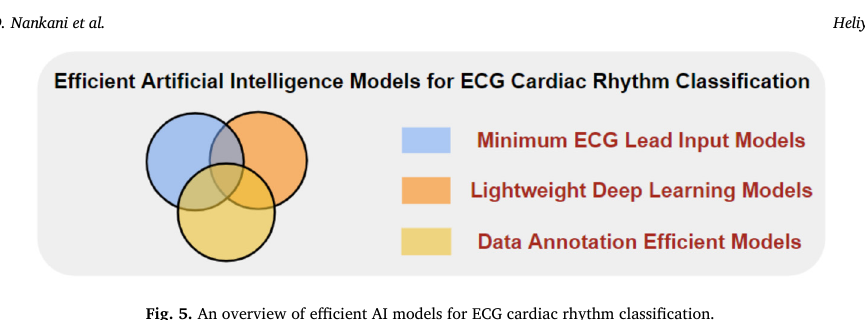

这篇笔记把原有的 ECG 核心概念复习与两篇综述的精读放在一起：先理解信号和模型，再看高效训练与部署，最后判断论文里的高分究竟能说明什么。

**最值得记住的一点：分类指标很高，还不足以证明模型能在真实临床中可靠工作。** 读论文时，需要同时检查数据划分、类别不平衡、外部验证、设备成本，以及漏诊和误报的后果。

## 一页速览

| 知识模块 | 核心概念 | 读完应能回答的问题 |
| --- | --- | --- |
| ECG 基础 | P/QRS/T、导联、单标签与多标签 | 模型输入是什么，预测的又是什么？ |
| 信号表示 | 标度图、递归图、小波散射 | 为什么把 1D 信号变成图像或稳定特征？ |
| 模型架构 | 1D-CNN、Bi-LSTM、TCN、GCN、Transformer | 模型利用了局部、时间还是导联间的信息？ |
| 高效 AI | 少导联、蒸馏、剪枝、量化、少标注 | 节省的是采集、计算还是标注成本？ |
| 安全与泛化 | 联邦学习、UQ、患者级划分、外部验证 | 换患者、设备或医院后，表现还能保持吗？ |
| 诊断统计 | Sensitivity、Specificity、PPV、LR、DOR | 高准确率背后，漏诊和误报各有多少？ |
| 综述图表 | PRISMA、森林图、HSROC、置信区间 | 汇总结果的不确定性和适用边界是什么？ |
| 研究设计 | 基线、消融、校准、部署测量 | 怎样把一个想法变成可检验的问题？ |

## 1. 两篇综述各自解决什么问题

| 论文 | 研究类型 | 主线 | 阅读价值 |
| --- | --- | --- | --- |
| Gupta et al., *Heliyon*, 2024 [1] | 叙述性综述 | 让 ECG 分类模型更高效 | 用少导联、轻量网络、少标注三条路线组织技术 |
| Bulbul et al., *Artificial Intelligence Review*, 2026 [2] | 系统综述与诊断准确性 Meta 分析 | 汇总 ECG 深度学习表现及临床转化缺口 | 学会区分高指标、可靠验证和真实临床收益 |

第一篇提供技术路线图，第二篇提供评价这些路线的证据视角。两篇都在整理已有研究；综述列举的某个模型成绩，不能直接当作统一条件下的模型排名。

本文中的公式算例和研究建议用于辅助理解，不是两篇论文新增的实验结果。

## 2. ECG 与信号表示：模型到底看到了什么

### 2.1 先分清波形、导联和标签

ECG（心电图）记录心脏电活动随时间的变化。P 波主要对应心房去极化，QRS 复合波对应心室去极化，T 波对应心室复极化；RR、PR、QT 等间期帮助描述节律与传导。

不同导联从不同方向观察电活动。12 导联包含较丰富的空间信息，而可穿戴设备常只有单导联或少量导联。减少导联能降低采集负担，也可能丢失对某些疾病有用的信息。

读方法部分时，先记录四件事：**导联数、采样率、输入时长、预测标签**。还要区分单标签分类与多标签分类：同一条 ECG 可能同时存在多种异常，未必适合强制只选一个类别。

### 2.2 标度图 / 尺度图（Scalogram）

标度图常由连续小波变换（CWT）得到。横轴为时间，纵轴为尺度或与尺度对应的频率，颜色通常表示小波系数的幅度或功率，具体应看图例。

它将 1D 心电信号转换为 2D 时频图，使 2D CNN 等视觉模型能够处理 ECG。但转换本身增加了预处理和存储成本，不能仅凭图像直观就认为一定优于直接输入波形。

### 2.3 递归图 / 重现图（Recurrence Plot）

递归图比较不同时间点的信号状态：如果时间点 i 和 j 的状态足够相似，就在对应位置做标记。它可以展示重复结构和非线性动态特征。

- 较长的对角结构，通常提示一段相似的动态演化。
- 碎片化结构可能反映更不规则的变化。
- 空白带可能与状态突变有关，也受阈值、嵌入参数和噪声影响。

**这些图形特征不能直接等同于某种心律失常的诊断。** 仍需结合信号、参数设置和标注验证。

### 2.4 小波散射（Wavelet Scattering）

小波散射通过预先设计的小波变换、非线性操作和平均处理提取特征。它在一定条件下具有对小幅形变的稳定性，并通过平均获得一定程度的平移不变性。

它有助于减少微小位移对特征的影响，但不意味着任何噪声或扭曲下都能保持同样的诊断能力。

## 3. 模型架构：先理解作用，再记名字

| 模型 | 主要处理什么 | 阅读时要注意 |
| --- | --- | --- |
| 1D-CNN | 波形中的局部模式，如 QRS 附近形态 | 卷积感受野是否覆盖目标病理特征？ |
| Bi-LSTM / GRU | 时间序列中的依赖 | 双向模型使用未来上下文，在线使用时要考虑窗口与延迟 |
| TCN | 用膨胀卷积扩大时间感受野 | 因果性、感受野和计算成本如何设置？ |
| GCN / Graph CNN | 导联等节点之间的关系 | 图的边来自生理先验、距离，还是模型学习？ |
| Transformer | 注意力机制建模较长距离的关联 | 数据量、序列长度和算力是否支持这种设计？ |

### 3.1 为什么引入图卷积

可以把导联视为节点，把导联之间的关系视为边。GCN 显式利用这些关系，尝试建模多导联的协同变化。

需要纠正一个常见简化：**多通道 1D-CNN 也可以混合导联信息，并非天然把每条导联完全独立处理。** GCN 的特点在于显式引入图结构，是否更好要通过公平比较和消融来验证。

### 3.2 多模态融合

ECG 可以与年龄、性别、病史或临床文本共同输入模型。例如用 TCN/Transformer 处理波形，用文本编码器处理病历，再融合特征。

BERT 更适合文本输入；年龄、性别等结构化变量可以直接编码或交给小型网络，不必都转换为文本。关键在于：额外信息是否真实可获得，是否引入了标签泄漏，以及它在外部人群中是否仍然有效。

## 4. 第一篇综述：高效 ECG AI 的三条路线

*图 1｜Gupta 等人对高效 ECG AI 模型的分类。三条路线分别减少输入采集负担、模型计算负担和人工标注负担，也可以组合使用。摘自文献 [1] Fig. 5（PDF 第 7 页），由 PDF 渲染并裁剪，CC BY 4.0。*

### 4.1 少导联：减少输入负担

少导联适合穿戴设备和远程监测，但不能把某项研究中“2 导联与 12 导联表现接近”推广到所有疾病。需要核对任务、导联位置、患者群体和评价协议。

一个清晰的研究问题是：**在相同患者划分下，减少导联后损失多少性能，能换来多少采集便利？** 注意力、蒸馏和多标签处理可能缓解信息损失，但不能预先保证补回所有信息。

### 4.2 轻量化：减少计算和存储负担

| 方法 | 直观解释 | 必须检查的代价 |
| --- | --- | --- |
| 知识蒸馏（Knowledge distillation） | 大教师模型指导小学生模型 | 教师的错误会不会一起传给学生？ |
| 剪枝（Pruning） | 删除冗余权重、通道或卷积核 | 参数减少是否真的带来目标硬件加速？ |
| 量化（Quantization） | 用更低精度表示参数和执行运算 | 精度变化、算子支持与实际延迟如何？ |
| 轻量结构设计 | 使用深度可分离卷积或小网络 | 省下多少计算，牺牲了哪些类别的识别能力？ |

一个常见的蒸馏目标可以写成纯文本形式：

`L = (1 − α) × CE(y, p_student) + α × T² × KL(p_teacher,T || p_student,T)`

CE 表示与真实标签的交叉熵；KL 比较教师与学生在温度 T 下软化后的概率分布；α 调节两项权重。训练时通常固定教师模型。

例如教师对“房颤、正常”给出 [0.8, 0.2]，学生给出 [0.6, 0.4]。虽然两者都预测房颤，蒸馏项仍能推动学生靠近教师给出的概率关系。这是原理示例，不是某个模型的实测结果。

第一篇综述转述过约 262 倍压缩、准确率损失 0.81% 的特定研究结果。这个数字依赖原研究的任务、教师模型及评估条件，不能当成通用压缩承诺。

### 4.3 少标注：先利用无标签信号学习

自监督学习先用无标签 ECG 学到表示，再用少量标注微调。对比学习是其中一类方法，通过正负样本或不同视图之间的关系学习特征。

CLOCS 等框架围绕时间、导联和患者构建关系。不同方法的正负样本定义并不相同；也不能简单认为不同患者一定具有不同病理类别。

增强方式尤其关键：如果裁剪、扰动或变换消除了病理线索，模型可能学到错误的不变性。评估少标注方法时，应在相同标签比例下比较，并防止预训练数据与外部测试患者重叠造成泄漏。

### 4.4 “高效”最终需要测量

参数量小不必然等于运行快。除了分类指标，还应记录参数量、FLOPs/MACs、模型文件大小、目标设备延迟、峰值 RAM 和功耗；若声称实时运行，还要考虑采样窗口、预处理与通信耗时。

第一篇没有让所有模型在统一数据、划分和硬件上重跑，因此适合用来寻找技术方向，不能据此判定哪个模型全面最优。

## 5. 安全、隐私与不确定性

### 5.1 联邦学习与抗拜占庭聚合

联邦学习（FL）让数据保留在各机构，通过上传模型更新共同训练。中位数聚合、截断均值等方法可在相应假设下缓解异常更新或恶意投毒。

“数据不出院”并不自动保证隐私：模型更新仍可能泄漏信息，往往需要结合安全聚合、差分隐私等机制，并验证它们的性能代价。抗拜占庭方法也不能无条件保证系统安全。

### 5.2 不确定性量化（UQ）

Softmax 分数可能过度自信，尤其遇到训练中未见过的数据时。需要区分两类不确定性：

- **偶然不确定性（Aleatoric）**：与数据噪声、测量误差等有关。
- **认知不确定性（Epistemic）**：与模型知识有限、数据不足等有关。

UQ 的目标是帮助识别“可能不可靠”的预测；模型校准则检查预测概率与实际发生频率是否匹配。例如，一组预测概率约 80% 的病例，实际阳性比例是否也接近 80%。

实际系统可以把低质量信号或高不确定性病例转给医生复核（Human-in-the-loop），但转交阈值和工作负担同样需要验证。

## 6. 诊断统计：这些指标要能自己算

### 6.1 从混淆矩阵开始

TP 是真阳性，TN 是真阴性，FP 是假阳性，FN 是假阴性。

| 指标 | 公式 | 回答的问题 |
| --- | --- | --- |
| 灵敏度 / 敏感度（Sensitivity / Recall） | TP / (TP + FN) | 真实有病的人，识别出了多少？ |
| 特异度（Specificity） | TN / (TN + FP) | 真实无病的人，排除了多少？ |
| 阳性预测值（PPV / Precision） | TP / (TP + FP) | 被判为阳性的人，多少真的有病？ |
| 阴性预测值（NPV） | TN / (TN + FN) | 被判为阴性的人，多少真的无病？ |
| 准确率（Accuracy） | (TP + TN) / 总数 | 全部预测中，有多少正确？ |
| F1 | 2TP / (2TP + FP + FN) | Precision 与 Recall 的调和平均是多少？ |

例如 TP = 90、FN = 10、TN = 95、FP = 5，则灵敏度为 90%，特异度为 95%，PPV 约为 94.7%。

### 6.2 为什么准确率高仍可能不够

如果异常只占 1%，把所有人都判为正常，准确率也有 99%，但一个异常都没找出来。

再看一个假设算例：10,000 人中患病率为 1%，某检测灵敏度 97%、特异度 96%。那么大约有：

- 100 名患者中，97 人被识别，3 人被漏掉。
- 9,900 名非患者中，396 人被误报为阳性。
- 阳性预测值为 97 / (97 + 396)，约 **19.7%**。

所以，灵敏度 97% 不代表“阳性结果有 97% 的概率是真的”。筛查场景的患病率、误报成本和后续检查流程都会影响临床价值。

### 6.3 似然比与诊断优势比

`LR+ = 灵敏度 / (1 − 特异度)`

`LR− = (1 − 灵敏度) / 特异度`

`DOR = LR+ / LR− = (TP × TN) / (FP × FN)`

上面的比值形式要求相关分母非零；遇到零计数时，统计分析需要相应处理。

**DOR 不能写成“真阳性率 / 假阳性率”——后者是 LR+。** DOR 衡量整体区分能力，但把灵敏度与特异度压成一个数，会掩盖两者的不同取舍。

若灵敏度为 0.97、特异度为 0.96，则 LR+ = 24.25，LR− = 0.03125，DOR = 776。这是公式演示，不是对文献汇总值的重新估计。

似然比更新的是优势（odds）：`后验优势 = 先验优势 × LR`，其中 `优势 = 概率 / (1 − 概率)`。1/LR− 描述阴性结果使患病优势缩小的倍数，不能直接当成患病概率缩小的倍数。

LR+ > 10、LR− < 0.1 常作为较强诊断证据的经验参考，仍需结合置信区间、患病率和临床任务；DOR 也不存在适用于所有场景的单一“合格线”。

## 7. 第二篇综述：如何读 Meta 分析和图表

### 7.1 85 篇和 27 篇不是同一个样本范围

第二篇遵循 PRISMA 报告框架，并在 PROSPERO 注册（CRD42023478008）。它从 8 个数据库识别出 1,068 篇记录，最终纳入 85 篇研究，其中 27 篇具有可用于定量分析的混淆矩阵信息。

PRISMA 是报告指南，PROSPERO 是注册平台，不能把两者混写为“在 PRISMA 注册”。也要区分“纳入系统综述的研究”和“进入 Meta 分析的研究”。

### 7.2 汇总结果说明什么

原文第 5 节报告，全部 27 篇研究的汇总灵敏度为 **97.12%**（95% CI：94.44%–98.53%），汇总特异度为 **96.30%**（95% CI：94.17%–97.67%）。摘要将其概括为约 97% 和 96%。

这些是跨研究的模型估计，并非一个新模型在一所新医院的测试成绩。不同疾病、导联、标签、阈值和参考标准会影响可比性；能提供混淆矩阵的研究也未必代表全部研究。

### 7.3 森林图（Forest Plot）

森林图中的点表示单项研究的估计值，横线通常表示 95% 置信区间。颜色和点形要以实际图例为准。

- 区间较短，表示该估计的不确定性较小；样本量是影响因素之一。
- 区间较长，表示估计更不精确。
- 区间很短也不能排除数据泄漏、选择偏倚或错误标签。

### 7.4 HSROC：汇总点、置信区域与预测区域

HSROC（分层汇总 ROC）用于诊断准确性 Meta 分析，描述研究间诊断表现及阈值相关变化。汇总点是统计模型估计，不宜简单理解为把所有分数做算术平均。

读图先确认坐标轴：常规 ROC 横轴是假阳性率（1 − 特异度），纵轴是灵敏度，理想点为 **(0, 1)**。若图的横轴直接画特异度，或将其反向排列，就要依照实际标注判断，不能把“左上角”固定写成 (1, 1)。

| 图中元素 | 表达的含义 | 不能直接推断什么 |
| --- | --- | --- |
| 汇总点 | 模型估计的综合诊断表现 | 不保证新患者群体有同样表现 |
| 95% 置信区域 | 汇总点估计的不确定性 | 区域小不等于研究间结果一致 |
| 预测区域（若提供） | 新研究的真实表现可能分布的范围 | 不等于单个患者的预测区间 |

原笔记把“小置信圈”解释为“研究更一致”，这里应区分：**汇总估计精确**与**研究间异质性小**是不同概念。

### 7.5 异质性与阈值效应

异质性可能来自人群、疾病谱、导联、采集设备、预处理、标签与参考标准等差异。阈值效应是其中一类来源：同一评分系统降低阳性阈值，通常会提高灵敏度、降低特异度。

跨研究的相关性还受其他差异影响，不能说所有研究一定呈强负相关。第二篇在 MIT-BIH 子集报告了较强的负相关，但在全部 27 篇研究中报告的相关性较弱，提示不同分析范围的阈值效应并不相同。

### 7.6 原文中的统计口径也要核对

第二篇第 4 节写约 31.8% 的研究做了外部交叉验证，第 6.5 节写 35.3%，并另提到 14.1% 同时做内部与外部验证。这些描述的口径或统计存在不一致，写自己的论文时，应回到定义和纳入研究逐项核对，不能随意选择一个百分比。

可解释性分析只涉及 8/85 篇，是该综述样本内的统计，不能推广为整个领域的精确比例。同样，“综述未提供充分患者结局证据”不能写成“任何 ECG AI 都没有临床价值”。

## 8. 从高分到临床可用：验证怎么设计

### 8.1 患者级划分与数据泄漏

把同一患者的不同心搏或相邻片段随机分到训练集和测试集，可能让模型借助患者特征或近重复波形获得偏乐观的成绩。

若目标是预测未见过的患者，应先按患者划分数据，再进行分段、增强等处理。标准化参数、特征选择和阈值调节也应只使用训练或验证数据，不能借用最终测试集。

受试者内（Intra-subject）评估和受试者间（Inter-subject）评估回答不同问题：前者可能适用于个体化系统，后者更关注新患者泛化。阅读时必须先看具体定义，不能只看名称。

### 8.2 内部验证、外部验证与临床实用性

同一数据库内的 k-fold 交叉验证属于内部验证。来自其他医院、设备、时间段或独立人群的测试，可以检验相应分布变化下的泛化，但仍需说明样本和使用场景。

外部验证是重要一步，单次外部测试也不足以证明全面临床价值。临床实用性（Clinical utility）还涉及前瞻性验证、工作流、净获益、误报负担，以及患者结局。

第二篇讨论了一些真实场景研究，包括以医生判读作为参考的研究；这与证明 AI 全面优于医生或改善患者结局不是同一件事。笔记应保留这种证据层级的区别。

### 8.3 读每篇模型论文时的六个问题

1. 具体任务是什么：筛查、诊断、持续监测，还是预后预测？
2. 解决的是导联少、算力小、标签少，还是跨人群泛化？
3. 基线是否采用同样的数据划分、调参机会和评价指标？
4. 类别不平衡时，各类召回率、宏平均 F1、PR 曲线等表现如何？
5. 是否做了消融、噪声测试、校准分析和适当的外部验证？
6. 错误集中在哪些患者或类别，临床后果与部署代价是什么？

## 9. 给初学者的学习路线与选题练习

| 阶段 | 优先掌握 | 一个可执行的小目标 |
| --- | --- | --- |
| 1. 看懂数据 | P/QRS/T、采样率、导联、常见节律 | 画出一条 ECG，标明输入长度和标签 |
| 2. 算清指标 | 混淆矩阵、ROC/PR、类别不平衡 | 手算灵敏度、特异度、PPV 和 F1 |
| 3. 跑通基线 | 1D-CNN、患者级划分、训练与验证 | 建立一个无患者交叉泄漏的基线实验 |
| 4. 检验改进 | 少导联、蒸馏、量化、自监督 | 一次只改变一个因素，做公平比较 |
| 5. 检查应用边界 | 外部验证、校准、噪声、延迟 | 报告模型在哪些条件下失效 |

选题时，把“用某个热门模型”改成可检验的问题。例如：

- **少导联与轻量化**：固定患者划分后，减少导联和量化分别怎样影响少数类召回率、设备延迟与内存？
- **自监督与泛化**：固定标注比例，预训练的收益在外部数据集上是否仍然存在？
- **噪声与可靠性**：加入信号质量筛选后，误报能减少多少，会漏掉多少困难病例？

这些是研究练习方向，不构成新颖性保证。正式选题前还需要检索近期研究、确认数据可用性，并确定比较协议。

## 两篇综述对照复习

| 对比维度 | 第一篇：高效 AI 综述 | 第二篇：系统综述与 Meta 分析 | 对自己的研究有什么用 |
| --- | --- | --- | --- |
| 核心问题 | 怎样降低 ECG AI 的使用成本？ | 现有证据支持多强的诊断能力？ | 同时定义技术目标和证据目标 |
| 组织方式 | 少导联、轻量网络、少标注 | 检索筛选、研究提取、定量合并 | 分清技术分类与证据汇总 |
| 值得掌握 | 蒸馏、剪枝、量化、自监督 | LR、DOR、森林图、HSROC | 能解释机制，也能解释指标 |
| 主要边界 | 模型间实验条件不统一 | 异质性、报告不一致、外部验证有限 | 避免直接横比排行榜数字 |
| 下一步 | 在目标设备测量成本 | 在独立人群验证收益 | 用明确协议检验改进是否有效 |

## 附录：术语纠错与拼写

| 术语 | 正确理解 | 常见误区 |
| --- | --- | --- |
| Precision | 分类任务中通常指查准率 / PPV；统计语境也可指估计精密度 | 与 Accuracy 混用，或拼成 Precession（进动） |
| Sensitivity / Recall | 在二分类中通常对应真阳性率 | 当作阳性预测值 |
| DOR | LR+ / LR− | 写成真阳性率 / 假阳性率 |
| Confidence region | 汇总估计的置信区域 | 把区域小当成没有异质性 |
| Exploit / Leverage | 技术语境中常指利用某种特征或资源 | 脱离语境固定翻译为“剥削”，或认定永远是褒义 |
| Trade-off | 权衡 / 取舍 | 忽略改善一个指标可能付出的代价 |
| Subject / Patient | 受试者 / 患者，依研究人群选择 | 默认所有受试者都患病 |
| Out-of-Distribution（OOD） | 与训练分布不同的数据 | 仅理解为模型没见过的单个样本 |
| PRISMA / PROSPERO | 前者是报告指南，后者是注册平台 | 混写为“PRISMA 注册” |

## 参考来源与图片说明

1. Gupta U, Paluru N, Nankani D, et al. *A comprehensive review on efficient artificial intelligence models for classification of abnormal cardiac rhythms using electrocardiograms*. Heliyon. 2024;10:e26787. [DOI: 10.1016/j.heliyon.2024.e26787](https://doi.org/10.1016/j.heliyon.2024.e26787).
2. Bulbul AAM, Awal MA, Mahendran N, et al. *Deep learning for ECG-based cardiovascular disease diagnosis: a systematic review and meta-analysis*. Artificial Intelligence Review. 2026;59:136. [DOI: 10.1007/s10462-025-11479-1](https://doi.org/10.1007/s10462-025-11479-1).

正文图 1 来自文献 [1] Fig. 5，遵循原论文的 [CC BY 4.0 许可](https://creativecommons.org/licenses/by/4.0/)，此处仅作渲染与裁剪，未改变图意。文章封面为单独的装饰插画，不属于上述论文图表。
