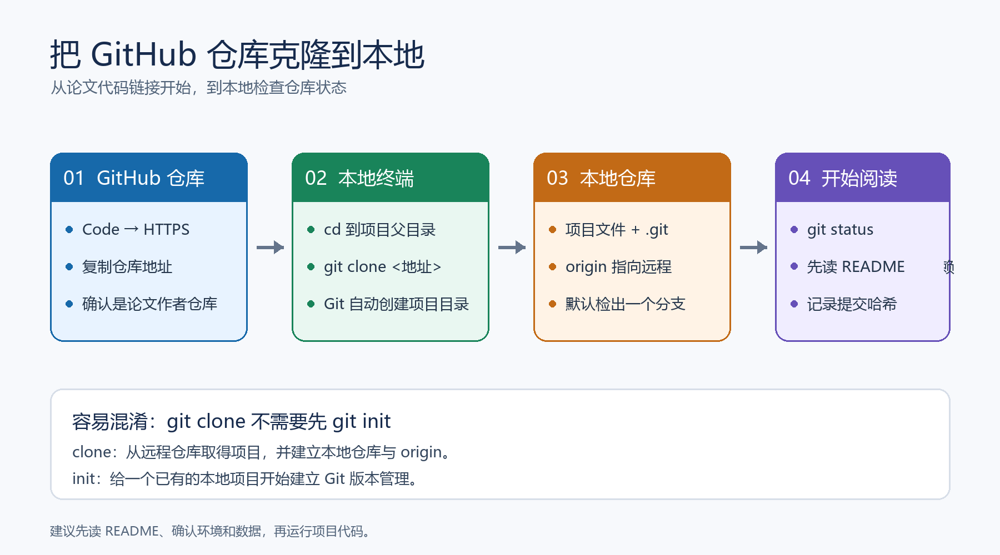

## 一页速览

| 问题 | 一句话回答 |
| --- | --- |
| `git clone` 做什么 | 把远程仓库复制到本地，同时建立 `.git` 仓库信息和名为 `origin` 的远程地址 |
| 从哪里拿地址 | GitHub 仓库页的 **Code → HTTPS**，复制 `.git` 地址 |
| 在哪里运行命令 | 先进入打算存放项目的父目录，再运行 `git clone <仓库地址>` |
| 克隆前要不要 `git init` | 不要；`git clone` 会初始化本地仓库。`git init` 用于从空目录开始建立新仓库 |
| 怎么确认成功 | 进入项目目录，运行 `git status` 和 `git remote -v` |
| 克隆后第一件事 | 阅读 `README`、依赖清单和数据说明，先确认运行条件再执行项目代码 |



*图 1：复制仓库 HTTPS 地址，在本地父目录执行 `git clone`；克隆后检查工作区状态和远程地址。此图为本笔记重绘。*

## 1. 这篇笔记的来源与用途

给出的链接是一篇 CSDN 操作教程《如何在 GitHub 上克隆项目（超详细的图文并解）》，不是学术论文。本文沿用它的核心流程，并把它整理成研0下载论文配套代码时可以直接照做的步骤；命令细节以 Git 的 `clone` 行为为准。

读论文时经常会遇到作者提供的 GitHub 仓库。克隆（clone）是把仓库及其版本记录取到本地的操作。它适合后续阅读代码、切换版本、运行实验和记录修改；单纯下载 ZIP 则更像拿到某一时刻的文件快照。

## 2. 先准备 Git 和目标目录

### 2.1 安装并确认 Git

在 Windows 上安装 Git for Windows。安装完成后，打开新的 PowerShell 或 Git Bash，检查：

```powershell
git --version
```

如果系统提示找不到 `git`，先确认安装完成，并重新打开终端，让新的 PATH 设置生效。也可以在文件资源管理器中进入目标目录，右键打开 Git Bash。

### 2.2 选好项目的存放位置

先决定多个研究项目共同放在哪个父目录，例如：

```text
D:\research\code
```

进入这个目录后再克隆。通常不需要提前创建与仓库同名的非空文件夹，因为 Git 会根据仓库名自动创建项目目录；如果要自定义目录名，可以把它作为 `git clone` 的第二个参数。

## 3. 从 GitHub 复制仓库地址

1. 打开论文提供的仓库链接。
2. 点击仓库页的 **Code**。
3. 选择 **HTTPS**，复制显示的地址，例如 `https://github.com/作者名/项目名.git`。
4. 确认这是论文正文或官方补充材料指向的仓库；相似名称的个人 fork 不一定是作者维护的版本。

公开仓库通常可以直接用 HTTPS 克隆。私有仓库需要账号具备访问权限；遇到认证提示时按 GitHub 当前的认证流程处理，不要把访问令牌写进命令、笔记或截图。

## 4. 执行克隆并确认文件

在 PowerShell 中进入项目父目录，然后运行：

```powershell
cd D:\research\code
git clone https://github.com/作者名/项目名.git
cd 项目名
git status
git remote -v
```

也可以把仓库地址替换成实际复制的 HTTPS 地址。默认情况下，Git 会新建一个与仓库同名的目录，下载默认分支的工作文件，并设置 `origin` 指向原仓库。`git status` 显示当前分支和工作区状态；刚克隆且没有改动时，通常会显示工作区干净。`git remote -v` 则应能看到 `origin` 的 fetch 和 push 地址。

若希望目录名不同：

```powershell
git clone https://github.com/作者名/项目名.git 论文代码
cd 论文代码
```

克隆结束后不要只看终端有没有出现 `100%`。检查目标文件夹确实生成、`git status` 能读取仓库、README 和依赖文件都在，才算完成本地准备。

### 为什么通常不先运行 `git init`？

原教程把 `git init` 放在 `git clone` 前面，但对标准的 `git clone <地址>` 流程来说，这一步多余。`clone` 会创建本地仓库元数据、检出文件并配置远程地址；手工先初始化容易让初学者误以为两个命令必须成对使用。

`git init` 适用于另一种场景：你有一个尚未纳入 Git 管理的本地项目，想从这里开始建立版本库。它不是克隆远程仓库的前置步骤。

## 5. 克隆、下载 ZIP 与复现准备

| 方式 | 得到什么 | 能否查看提交记录 | 适合场景 |
| --- | --- | --- | --- |
| `git clone` | 本地工作文件、Git 仓库信息和远程地址 | 可以；也便于切换提交或分支 | 阅读作者代码、复现实验、跟踪后续更新 |
| GitHub 下载 ZIP | 当前页面对应版本的文件压缩包 | 不包含完整 Git 仓库记录 | 只想快速查看一次性快照 |

克隆仓库只是拿到代码，不等于实验已经复现。下一步先看 README，记录作者推荐的提交版本、Python 或框架版本、数据集获取方式、运行入口和随机种子。不要默认“最新版”就是论文实验用的版本，也不要在未阅读说明前运行未知脚本。

## 6. 常见问题排查

| 现象 | 常见原因 | 先检查什么 |
| --- | --- | --- |
| `git` 不是命令 | Git 未安装，或终端没有读取新的 PATH | `git --version`；重新打开终端 |
| `Repository not found` | 地址拼错、仓库迁移/删除，或私有仓库权限不足 | 浏览器能否打开仓库；复制 Code 中的地址；确认访问权限 |
| 目标目录已存在且非空 | 当前目录下已有同名文件夹 | 换一个父目录或克隆目标目录名；不要直接覆盖已有项目 |
| 下载中断或连接失败 | 网络、代理或 GitHub 连接不稳定 | 检查网络后重试；确认仓库本身可访问 |
| 克隆成功但不知道如何运行 | 缺少环境、数据或特定版本要求 | 从 README、requirements/environment 文件和论文实验设置开始核对 |

如需重试，先确认失败过程中是否留下了目标目录，以及其中有没有自己新增的文件。不要为了“清干净”直接删除不确定是否有用的目录。

## 7. 克隆后的研0检查清单

1. 对照论文确认仓库作者、链接和项目名称。
2. 阅读 README，找出推荐的代码版本和运行入口。
3. 记录 `git rev-parse HEAD` 的结果，固定本次阅读/实验对应的提交。
4. 先创建独立环境，再按项目说明安装依赖。
5. 确认数据集许可、下载方式和目录结构，不把私有数据提交到公开仓库。
6. 运行最小示例后，再开始完整实验；出现差异时同时记录代码版本、环境、命令和日志。

```powershell
git rev-parse HEAD
git status --short
```

前一条命令记录当前代码版本的提交哈希，后一条查看是否已经有本地改动。它们能帮助区分“作者提供的原始代码”和“自己修改后的实验代码”。

## 操作方式对比

| 维度 | 网页下载 ZIP | HTTPS `git clone` | SSH `git clone` |
| --- | --- | --- | --- |
| 是否需要先配置认证 | 公开仓库通常不需要 | 公开仓库通常不需要；私有仓库需授权 | 需要预先配置 SSH 密钥 |
| 是否带版本库信息 | 否 | 是 | 是 |
| 是否保留原仓库远程地址 | 否 | 是，默认名为 `origin` | 是，默认名为 `origin` |
| 初次上手成本 | 最低 | 低 | 较高 |
| 本文建议 | 一次性看文件可用 | 初学复现优先掌握 | 已配置 SSH 后使用 |

## 附录：来源与术语

- 原文：齐天大圣_DS，《如何在GitHub上克隆项目(超详细的图文并解)》，CSDN，2022-11-15，[原文链接](https://blog.csdn.net/qq_48271007/article/details/126050656)。原文标注 CC BY-SA 4.0；本文为改编，重新组织了文字并自行绘图，保留出处，并按 CC BY-SA 4.0 分享。
- 命令依据：[Git 官方 `git-clone` 文档](https://git-scm.com/docs/git-clone)。

| 术语 | 含义 | 易混点 |
| --- | --- | --- |
| 仓库（repository） | Git 管理的一份项目及其版本记录 | 不只是 GitHub 网页上的文件列表 |
| 克隆（clone） | 从现有仓库建立本地副本并配置远程地址 | 不等于只下载当前文件快照 |
| 远程（remote） | 本地仓库记住的远端仓库地址 | `origin` 是常见默认名称，不是特殊命令 |
| 初始化（init） | 在现有本地目录中新建 Git 仓库 | 克隆远程仓库时一般不需要预先执行 |
| 分支（branch） | 指向一条开发历史的可移动引用 | clone 后默认检出一个分支；不代表所有分支都同时成为本地工作目录 |
