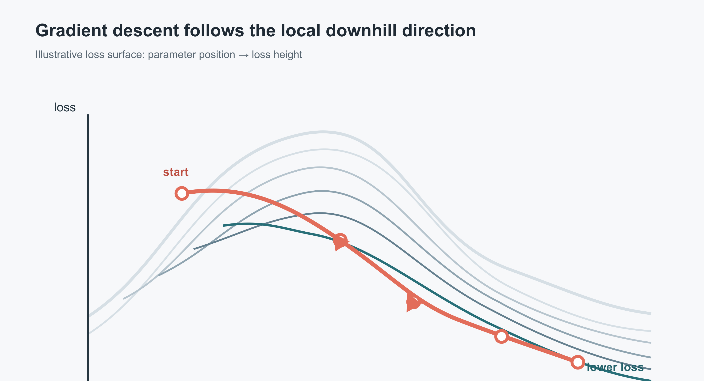
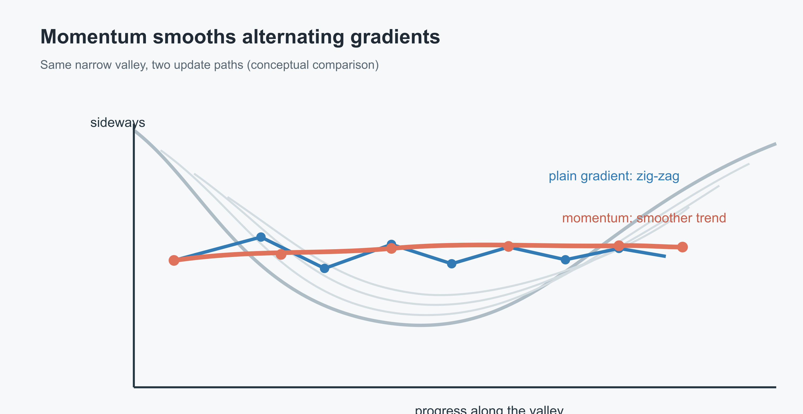
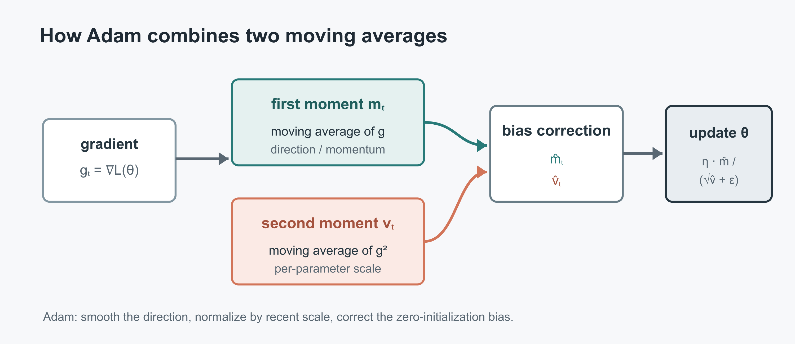

# 从梯度下降到 Adam：一步步理解优化器

> **整理依据**：B 站《【梯度下降】3D可视化讲解通俗易懂》和《拒绝死记硬背!手把手带你“发明”Adam优化器(动量/RMSprop/Adam)》。本文把两段视频串成一条线：先弄清楚参数为什么要沿负梯度移动，再看动量和自适应步长怎样改进这条更新规则。配图是根据概念重新绘制的示意图，不是视频原帧。

## 0. 一页速览

| 问题 | 一句话回答 |
| --- | --- |
| 训练在优化什么 | 调整模型参数 θ，让损失函数 L(θ) 变小 |
| 梯度告诉我们什么 | 各参数方向上的局部上升速度；最速下降方向是负梯度 −∇L |
| 学习率 η 做什么 | 把梯度转换成实际步长；太大会越过谷底，太小会走得慢 |
| Momentum 改进什么 | 累积梯度方向，减少来回摆动并加速持续一致的方向 |
| RMSprop 改进什么 | 按近期梯度平方的大小缩放每个参数的步长 |
| Adam 是什么 | Momentum 的一阶矩 + RMSprop 风格的二阶矩 + 偏差修正 |
| 最重要的边界 | 梯度下降通常只能保证局部改进；非凸问题不保证找到全局最小值 |

## 1. 从预测误差到损失函数

模型先用参数 θ 对输入 x 做预测，再将预测值与真实值 y 比较。损失函数把误差量化成一个数：损失越大，当前参数下的预测通常越差；训练的目标是寻找一组让损失降低的参数。

以一元参数 w 的简单回归为例，假设模型预测为 ŷ = wx + b。对一批样本计算平方误差平均值，可以得到关于 w、b 的损失 L(w,b)。每一组参数都是参数空间中的一个点，而 L 的数值就是该点的“高度”。多参数时，这个地形存在于高维空间，三维曲面只是帮助直观理解的二维参数示例。



*图 1：参数是位置，损失是高度；算法在当前位置估计斜率，沿局部下降方向迈一步，再重新计算。*

## 2. 梯度下降：看斜率，走反方向

在当前位置 θ，梯度 ∇L(θ) 指向损失上升最快的方向。因此要降低损失，应沿负梯度方向更新：

```text
θₜ₊₁ = θₜ − η · ∇L(θₜ)
```

这里 θ 可以包含成千上万个模型参数；减号表示往下降方向走，η 是学习率。每次更新后，模型参数变了，新的梯度也要在新位置重新计算。

对单参数 w 来说，梯度就是损失曲线在 w 处的导数：

```text
wₜ₊₁ = wₜ − η · dL/dw
```

如果当前位置曲线向右上升，导数为正，减去正数会让 w 变小；若曲线向右下降，导数为负，减去负数会让 w 变大。两种情况下，参数都朝着局部损失较低的一侧移动。

### 2.1 学习率是步幅旋钮

- η 太大：更新一步可能跨过谷底，在两侧反复跳动，甚至发散。
- η 太小：方向可能没错，但每次移动很短，训练会很慢。
- 常见做法：先选一个合理初值，再配合学习率衰减、warmup 或自适应优化器调整。

### 2.2 BGD、SGD 与 Mini-batch

它们的区别主要是每一步用多少样本估计梯度：

| 方法 | 一步使用的数据 | 特点 |
| --- | --- | --- |
| Batch GD（BGD） | 整个训练集 | 梯度估计较稳定；数据集很大时每一步开销高 |
| SGD（严格称呼） | 一个样本 | 更新频繁、噪声较大；“SGD”在深度学习实践中也常被泛指小批量随机梯度下降 |
| Mini-batch SGD | 一小批样本 | 计算效率与梯度稳定性的折中，是常见训练方式 |

小批量梯度是整批梯度的带噪声估计。它并不能保证跳出局部极小值，也不保证全局最优；实际收敛还取决于损失地形、采样、初始化和学习率等因素。

## 3. Momentum：把近期方向记下来

普通梯度下降只看当前一步。若谷底狭长，梯度可能在陡峭方向左右交替，参数就会来回摆动；而在同一个方向上连续下降时，每一步又没有利用此前的趋势。

Momentum 用一个“速度”状态累积近期梯度：

```text
vₜ = βvₜ₋₁ + ∇L(θₜ)
θₜ₊₁ = θₜ − ηvₜ
```

β 越接近 1，历史梯度保留得越久。持续一致的方向会累积起来，方向反复变化的分量则容易互相抵消。可以把它想成有惯性的球：球会沿着连续的下坡方向加速，也不会因为一次小小的坡度变化立刻掉头。



*图 2：动量汇集近期方向，能平滑部分震荡；β 过大或学习率不合适时，惯性也可能导致超调。*

视频用逐步推导的方式引入动量。不同教材或框架对“速度”是否包含学习率、是否使用 (1−β) 缩放的记号不完全相同，比较实现时应看完整更新式，而不是只看变量名。

## 4. RMSprop：根据梯度尺度调节步长

不同参数的梯度可能有不同尺度。若所有参数共用同一个学习率，有的维度可能迈得过大，有的维度又迈得过小。RMSprop 维护梯度平方的指数移动平均：

```text
sₜ = ρsₜ₋₁ + (1−ρ)(∇L(θₜ))²
θₜ₊₁ = θₜ − η · ∇L(θₜ) / (√sₜ + ε)
```

平方、除法和平方根均按参数逐元素计算。梯度长期较大的参数会被较大的 √sₜ 缩小步长；梯度较小的参数相对保留较大的步长。ε 用来避免除以零并改善数值稳定性。

可以把它理解成“每个参数都有自己的步长调节器”。它跟动量解决的不是同一个问题：动量主要累计方向，RMSprop 主要归一化梯度尺度。

## 5. Adam：动量与自适应尺度的组合

Adam 同时追踪梯度的一阶矩（均值趋势）和二阶矩（平方尺度）：

```text
gₜ = ∇L(θₜ₋₁)
mₜ = β₁mₜ₋₁ + (1−β₁)gₜ
vₜ = β₂vₜ₋₁ + (1−β₂)gₜ²

m̂ₜ = mₜ / (1−β₁ᵗ)
v̂ₜ = vₜ / (1−β₂ᵗ)
θₜ = θₜ₋₁ − η · m̂ₜ / (√v̂ₜ + ε)
```

- mₜ 是梯度的指数移动平均，提供动量方向。
- vₜ 是梯度平方的指数移动平均，提供逐参数尺度调整。
- 两个状态通常从 0 初始化。训练刚开始时，零初始化会让指数移动平均偏向 0；除以 `1−βᵗ` 对这种初始偏差作校正。
- β₁ 控制一阶矩记忆长度，β₂ 控制二阶矩记忆长度；常见默认值为 β₁=0.9、β₂=0.999，但不是所有任务的最佳选择。



*图 3：Momentum 贡献方向平滑，RMSprop 贡献逐参数尺度缩放，Adam 将二者组合并校正初始状态偏差。*

Adam 常是一个容易上手的默认选择，但不等于处处最优。学习率、权重衰减方式、数据和模型都会影响结果；做严谨比较时，应在同一数据划分和训练预算下观察验证集表现。

## 6. 三类更新规则对比

| 优化方法 | 维护的状态 | 每个参数的步长 | 主要优点 | 需要留意 |
| --- | --- | --- | --- | --- |
| SGD | 当前梯度（可扩展为动量） | 共享学习率 | 简单、更新含义直观 | 对学习率敏感，可能震荡或收敛慢 |
| Momentum | 梯度的一阶移动平均/速度 | 共享学习率 | 减少方向震荡，加速一致方向 | 惯性过强时可能超调 |
| RMSprop | 梯度平方的移动平均 | 按参数缩放 | 适应梯度尺度差异 | 原始版本通常没有 Adam 式偏差修正 |
| Adam | 一阶矩与二阶矩 | 按参数缩放 | 方向累计与尺度自适应兼备，早期偏差有校正 | 多了状态与超参数；自适应不保证更好泛化 |

## 7. 复习时最容易说错的地方

1. **不是沿梯度走，而是沿负梯度走。** 梯度指向局部上升最快处，下降要取相反方向。
2. **梯度不是损失值。** 损失衡量当前表现，梯度告诉参数微调时损失如何变化。
3. **学习率不是梯度本身。** 它是缩放更新量的超参数；梯度很大不代表一定要走很远。
4. **Adam 不只是“动量 + RMSprop”四个字。** 完整理解还要看到两个指数移动平均及其偏差修正。
5. **优化到低训练损失不等于泛化好。** 最终要看独立验证/测试数据上的表现，避免把训练集损失当作唯一目标。
6. **普通梯度下降没有无条件的全局最优保证。** 凸性、光滑性、步长条件等理论假设决定可以证明到什么程度；深度网络的损失通常是非凸的。

## 附录 | 视频来源

- 梗直哥丶：《【梯度下降】3D可视化讲解通俗易懂》，[B 站 BV18P4y1j7uH](https://www.bilibili.com/video/BV18P4y1j7uH/)（约 12 分钟）。官方嵌入：

<iframe width="100%" height="468" src="//player.bilibili.com/player.html?isOutside=true&aid=891549064&bvid=BV18P4y1j7uH&cid=437149663&p=1" scrolling="no" border="0" frameborder="no" framespacing="0" allowfullscreen="true"></iframe>

- 算法魔法师：《拒绝死记硬背!手把手带你“发明”Adam优化器(动量/RMSprop/Adam)》，[B 站 BV1sgivBFEDq](https://www.bilibili.com/video/BV1sgivBFEDq/)（12 分钟）。官方嵌入：

<iframe width="100%" height="468" src="//player.bilibili.com/player.html?isOutside=true&aid=115830503249253&bvid=BV1sgivBFEDq&cid=35162751839&p=1" scrolling="no" border="0" frameborder="no" framespacing="0" allowfullscreen="true"></iframe>

*笔记按视频的教学主线整理，并使用标准优化器记号校正了简写。图中轨迹仅用于说明更新方向，不代表某个真实模型或实验结果。*
